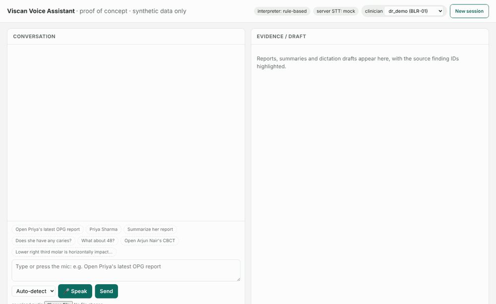
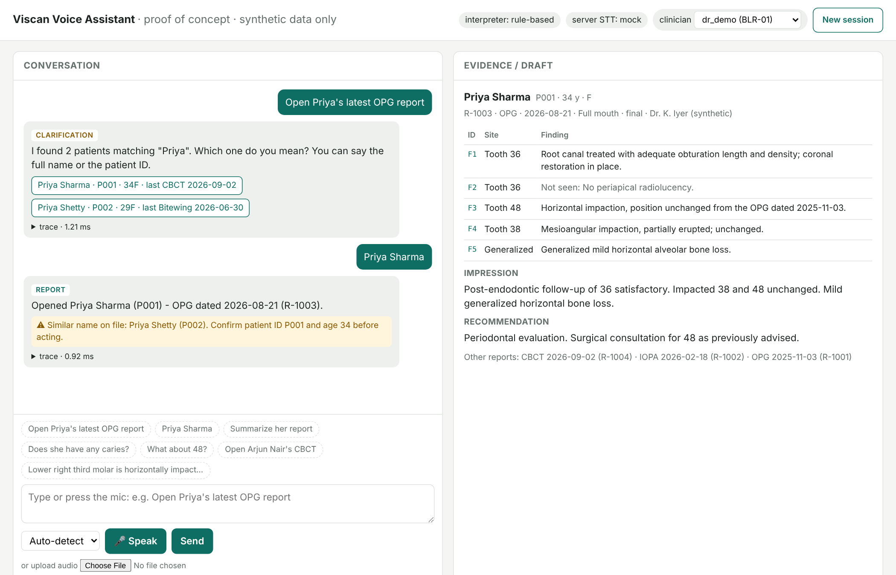
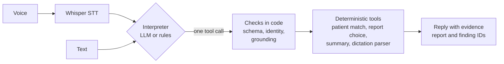

# Viscan Voice Dental Assistant

[](https://github.com/DrEnosh/Vi-scan/actions/workflows/tests.yml)

A voice-first assistant for a dental imaging workflow, built as a proof of concept for the VI-SCAN Diagnostics AI Engineer take-home. A clinician says "Open Priya's latest OPG report", follows up with "Summarize her report", and dictates findings like "Lower right third molar is horizontally impacted" to get an editable, structured draft report. All data is synthetic.



## In short

- **Finds the right report from speech or text**, and asks when a name is ambiguous instead of guessing.
- **Answers follow-ups from the report itself.** "Summarize her report" and "Does she have any caries?" use the patient already open, and every line cites the report and finding it came from.
- **Turns dictation into a draft report** with FDI tooth numbers, negation and hedging kept, and nothing added that wasn't said. A clinician edits and approves it.

The design rule is safety before fluency. The LLM only proposes a tool call; plain code decides which patient, which report, and whether a finding was really said. Without an API key, a rule-based interpreter makes the same tool calls, so everything also runs offline.

## Results

| Check | Result |
|---|---|
| Automated tests | 90 passing on Python 3.11 to 3.14, plus 4 live API tests run on demand |
| Evaluation set: 134 labelled utterances, offline rules | 96% right action, 97% right patient, dictated findings F1 0.97 |
| Same set, live model (Groq `gpt-oss-120b`) | 92% right action, 86% right patient, findings F1 0.96, median 764 ms per call |
| Replies that showed the wrong patient's report | 0 offline (CI fails the build otherwise). The first live run found 1; fixed, and the re-run shows 0 |
| Live run on Groq (`gpt-oss-120b` + Whisper) | 9 of 9 correct tool choices; a spoken command takes about 1.3 s on the server, audio to answer |

How these were measured, and every case that failed: [docs/EVAL.md](docs/EVAL.md).

## Quick start (no keys needed)

Python 3.11 or newer.

```bash
python -m venv .venv && source .venv/bin/activate      # Windows: .venv\Scripts\activate
pip install -r requirements.txt
cp .env.example .env                                     # Windows: copy .env.example .env
uvicorn app.main:app --reload --port 8000
```

On Windows you can double-click `start.bat` instead. It creates `.venv`, installs everything, and opens http://localhost:8000.

Things to try, in order, in one session:

1. `Open Priya's latest OPG report` → asks which Priya
2. `Priya Sharma` (or click the button) → opens R-1003, with a look-alike name alert
3. `Summarize her report` → summary built from the report's own lines, each with its finding ID
4. `Does she have any caries?` → R-1003 doesn't mention caries, so it says so and points to R-1002 and R-1001
5. `Lower right third molar is horizontally impacted with roots close to the mandibular canal. Possible caries on 46. No periapical radiolucency in relation to 36.` → a draft with four findings to edit and approve



Tests, lint and the evaluation:

```bash
pytest                       # 90 passed, 4 skipped (the live API tests)
ruff check .
python scripts/run_eval.py   # scores eval/cases.jsonl
```

## Turn on the LLM and real voice (free Groq key)

One free key from console.groq.com covers both the LLM and Whisper.

1. `pip install -r requirements-providers.txt`
2. In `.env`: `INTERPRETER=groq`, `STT_PROVIDER=groq`, `GROQ_API_KEY=gsk_...`
3. Check it end to end: `python scripts/check_llm.py`. It makes one direct call (with a plain-English message if the key, model, rate limit or network is the problem), runs a short conversation through the app, and confirms Whisper rejects a silent clip.
4. Restart the server. The header shows the model, and each answer shows its latency and tokens.

On Windows, `run_check.bat` does all of this in one go and writes `check_output.txt`; `docs/LIVE_RUN.md` is its output on my machine. If the LLM is unreachable or returns something unusable, that request falls back to the rules immediately and the UI says so.

## Model and provider choices

- **LLM: `openai/gpt-oss-120b` on Groq**, through OpenAI-compatible tool calling. The job is narrow (pick one of three tools and fill a few arguments), so a fast model with good tool use is enough: free to start, about a second per call, reasoning effort kept low. Any OpenAI-compatible API works by config (`INTERPRETER=openai_compat`).
- **Speech-to-text: Whisper `whisper-large-v3-turbo` on Groq**, with a dental-terms prompt and a guard against Whisper's silence hallucinations. OpenAI `whisper-1` by config; a mock provider for offline tests.
- **Rules as a twin.** A rule-based interpreter emits the same tool calls, so everything runs offline and the LLM has a fallback.
- **Extractive summaries.** Summaries quote the report's own lines with finding IDs instead of generating prose, so every line is traceable.

## Configuration

Environment variables (all of them, with comments, are in [`.env.example`](.env.example)):

```env
INTERPRETER=groq        # rule_based (default, offline) | groq | openai_compat
GROQ_API_KEY=           # one free key covers the LLM and Whisper
STT_PROVIDER=groq       # mock (default) | groq | openai
LLM_MODEL=              # empty = provider default (Groq: openai/gpt-oss-120b)
LLM_TIMEOUT_S=8         # after this, the request falls back to the rules
```

## Production notes

- **Privacy.** The LLM gets the utterance and a one-line context, never the patient list, report text or IDs. The audit log keeps IDs only, no transcript or clinical text. With real patients: a DPA or in-region self-hosting, zero retention, encryption at rest.
- **Authorization.** Every lookup is scoped to the clinician's clinics; other clinics' patients behave as if they don't exist. Sessions are bound to one clinician and drafts to their author. The header-based login is a stand-in for OIDC tokens and role checks.
- **Latency.** Measured live: Whisper 350–480 ms, model call about 0.8 s median, tools and validation about 1 ms. A spoken command takes about 1.3 s on the server, audio to answer.
- **Costs.** Free on Groq's free tier. At paid rates, about $0.0003 per spoken command (roughly $0.30 per 1,000); the offline mode costs nothing.
- **Failures and input checks.** A failed, slow or invalid model call falls back to the rules at once. Inputs are size-limited and schema-validated, and errors come back as clean JSON with no stack traces.

Details for each: [docs/REFERENCE.md](docs/REFERENCE.md).

## How it works



The interpreter picks one of three tools (report request, dictation, unsupported) and fills in arguments. Everything after that is ordinary code with tests: matching the patient within the clinician's clinic, choosing the report, building an extractive summary, and checking each dictated finding against the transcript. The LLM never sees the patient list or report text.

More detail: [docs/ARCHITECTURE.md](docs/ARCHITECTURE.md) (one page, also as [PDF](docs/architecture.pdf)) and [docs/REFERENCE.md](docs/REFERENCE.md) (configuration, API, model choices, production notes).

## Safety rules, enforced in code

1. **Identity is never guessed.** Two Priyas → it asks. "Pria Sharma" → it asks to confirm. An exact match still shows a look-alike alert with patient ID and age.
2. **The patient must come from what was said.** A pronoun has to fit the open patient ("his" while a female patient is open is questioned). A name the model returns that nobody said is discarded.
3. **Every model finding is grounded.** It survives only if its quote is in the transcript, the quote mentions that finding, the tooth matches, and negation matches the wording. Rejections are shown with reasons.
4. **Nothing is invented.** Speech outside the vocabulary is kept verbatim; an unspecified side ("lower third molar") stays unresolved; no impression or treatment advice is generated.
5. **Answers come from the report.** If something isn't documented, the reply says it can't confirm or rule it out.
6. **Drafts need a human.** Approval requires a linked patient and resolved teeth, and approved drafts are frozen.

## Known limitations

- The dictation vocabulary covers common radiographic findings, not all of dental radiology. Anything outside it is kept verbatim for the clinician.
- The offline interpreter handles common phrasings; unusual ones get a clarifying question. The LLM handles free phrasing better ([docs/EVAL.md](docs/EVAL.md) shows where each one fails).
- Live testing used clean text-to-speech audio. Real clinic audio with accents and noise still needs evaluating.
- Sessions and drafts are in memory, and authentication is a header stand-in for real tokens.
- English only, FDI numbering only.
- Out of scope by design, as the brief asked: PACS integration, image analysis, deployment and mobile packaging.

## Repository map

| Path | What it is |
|---|---|
| `app/` | FastAPI app: `orchestrator.py` (the pipeline), `interpreter/` (LLM and rules), `validation.py`, `dental.py` (vocabulary), `tools/` |
| `static/index.html` | The web UI (mic, chat, evidence panel, draft editor) |
| `tests/` | Automated tests, plus opt-in live API tests |
| `eval/cases.jsonl`, `scripts/run_eval.py` | Labelled evaluation set and its scorer |
| `docs/` | Architecture (MD + PDF), evaluation, reference, demo log, live run |
| `CHANGELOG.md` | What changed, day by day |
| `SUBMISSION_NOTE.md` | What works, what is incomplete, what I would do next |
